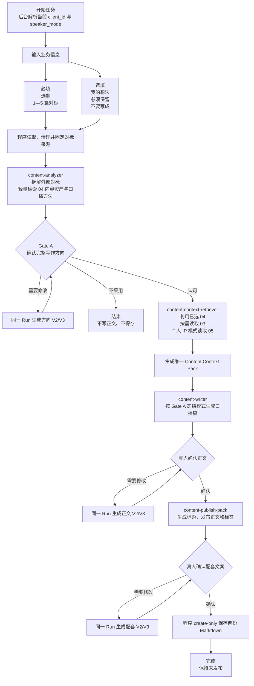
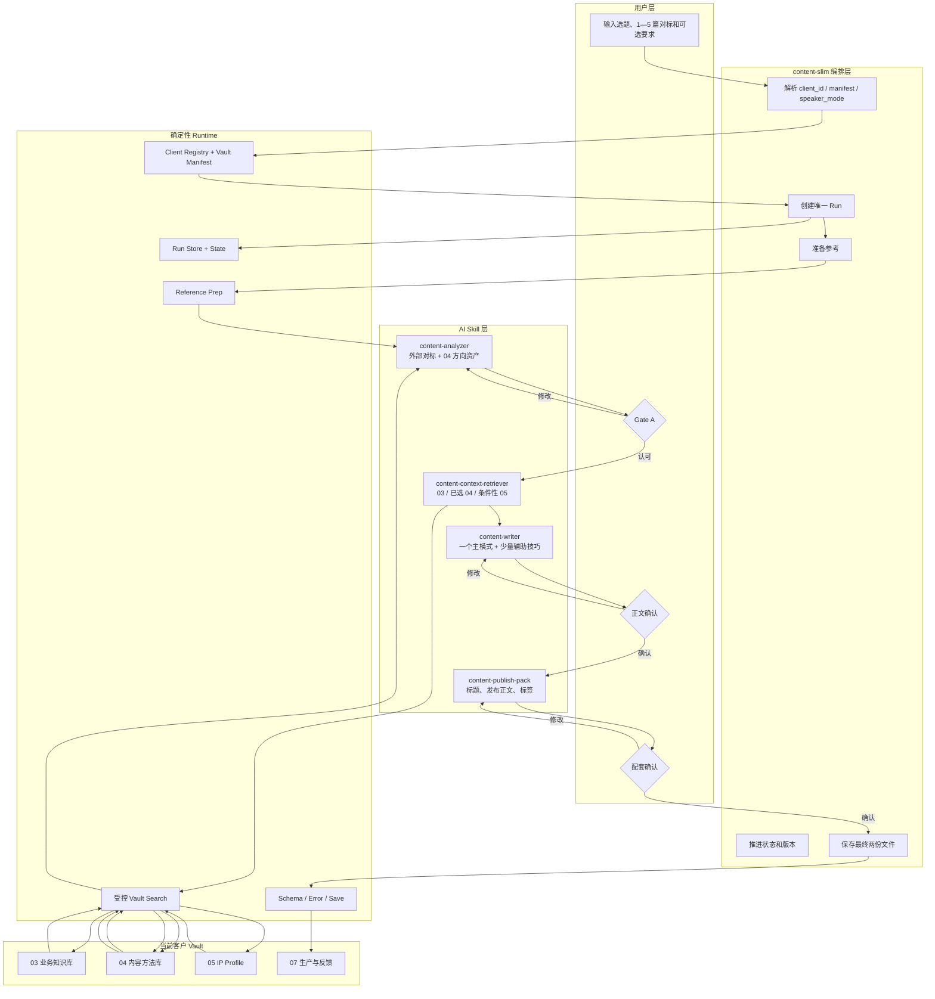
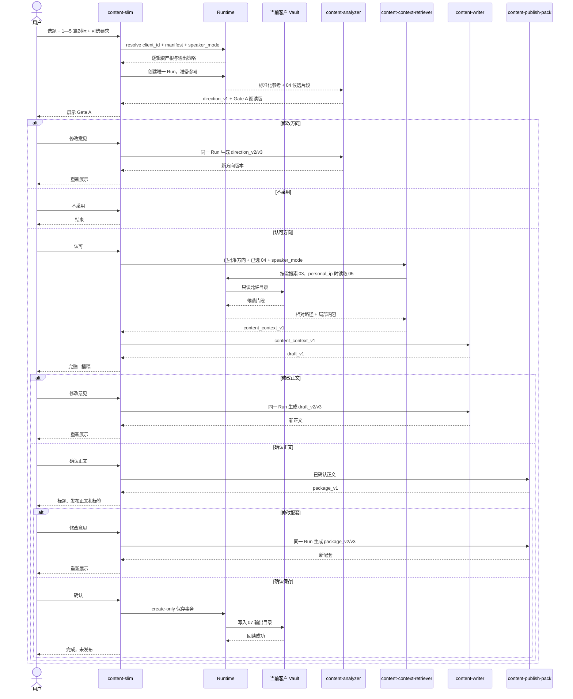
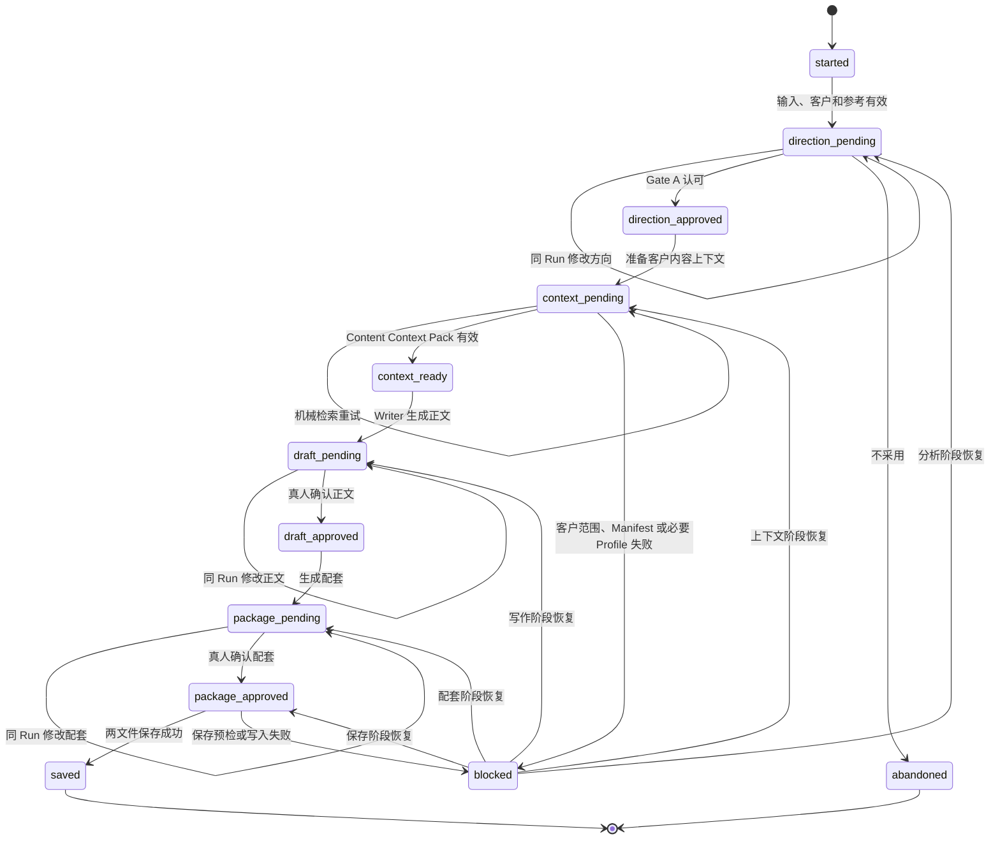
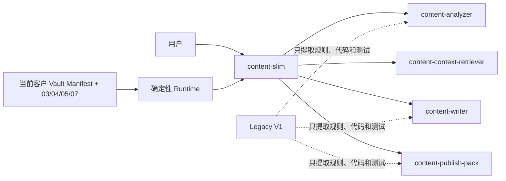

# Content V2 Slim 全周期开发与迁移 SPEC

> 文档性质：唯一实施主规范（Master SPEC）  
> 状态：P2 Gate 已通过；仅允许进入 P3 准备
> 日期：2026-08-18
> 产品决策人：用户  
> 需求与架构总控：ChatGPT Pro 当前对话  
> 本地执行者：Codex 新 Session  
> 目标仓库：`slbb1995/content-workflow-skills`  
> 审计分支：`audit/content-v1-slim-20260816`  
> 审计提交：`e5676f5686edded228c20006777ca11de21b93f8`  
> 冻结的旧主链代码基线：`6669b1055c8f14785c63739483669a3e720b5a83`（`0.10.0-rc.11`）  
> 建议开发分支：`feature/content-v2-slim`  
> 建议首个候选版本：`0.11.0-rc.1`，最终版本号在发布 Gate 决定  
> 本次修订：P2 治理收口版——接受 P2 实现，建立反膨胀执行与 Gate Review 宪法，并冻结 P3—P7 的复杂度预算

---

## 0. Codex 开始前必须先读

Codex 接到本文件后，必须先完整阅读，再用大白话复述以下六项，未经复述不得修改代码：

1. 用户真正要完成的业务结果；
2. 本轮为什么不再继续修补旧 Content V1 主编排；
3. 哪些旧能力只允许“提取后复用”，哪些旧 Skill 必须冻结并退出 Slim 运行依赖；
4. 为什么 04 在 Gate A 前参与方向，而 03/05 在 Gate A 后按需装配；
5. 所有新 Skill 为什么必须使用 `skill-creator` 创建或做结构性修改；
6. 当前被授权执行的阶段编号。

本文件覆盖完整周期，但**任何一个 Codex Session 默认只执行被明确指定的阶段**。启动任务时必须附带：

```text
EXECUTE_PHASE: P0 / P1 / P2 / P3 / P4 / P5 / P6 / P7
```

没有阶段编号时，只允许做只读定位和回报，不得自行从头执行到安装。

### 0.1 全程禁止事项

除非对应阶段明确授权，否则不得：

- 修改旧 Content V1 的生产行为来“顺手兼容”Slim；
- 直接修改 `~/.codex/skills`；
- 直接修改客户 Skill RC；
- 修改客户 Vault 的 01—05 业务资料；
- 合并或替换 `main`；
- 创建正式 Tag；
- 推送客户仓库；
- 自动保存、提交、推送或发布客户内容；
- 删除、覆盖或重签旧失败证据；
- 把旧全量测试红灯说成全绿；
- 为了让测试通过而放宽客户隔离、来源边界或人工确认；
- 恢复 Gate A 前独立 Reviewer；
- 在主链中增加新的独立 AI Reviewer；
- 让 AI 现场编写 `analyzer_program.py` 或其他临时执行程序；
- 把本地绝对路径、哈希、Packet、内部合同展示给普通用户；
- 未调用 `skill-creator` 就直接手写或复制一个完整新 Skill；
- 让新 Skill 直接运行时调用旧 V1 Skill；
- 让 Writer 自行扫描或检索客户 Vault；
- 扫描客户配置未授权的 Obsidian 目录；
- 把整个客户 Vault、整篇历史稿或大量无关笔记直接塞给 Writer；
- 把对标资料、客户内部资料和 IP 历史内容混成同一种来源。

### 0.2 项目总原则

> 用真实任务暴露问题，再把重复、过重、位置不合理的流程删除、合并或重新分配职责，让链路更短、更稳定。

第一性原理不是“代码越少越好”，而是：

> 用尽可能少的用户步骤、运行步骤和维护成本，稳定完成一篇可直接朗读的口播稿及配套文案。

### 0.3 Content V2 Slim 反膨胀执行与 Gate Review 宪法

本项目最主要的架构风险不是“能力不够”，而是 V2 再次复制 V1 的重型化。以下规则同时约束开发、Review 和 Gate 裁决。

#### 0.3.1 证据优先级与唯一阻断范围

证据从高到低为：真实黑盒任务中已经发生的失败；可稳定复现且直接影响当前业务结果的失败；静态代码中可确定必然发生的严重问题；理论风险、未来场景和极端可能性。前三类证据也只有命中以下四类阻断条件时，才允许给出 `CHANGES REQUESTED`：

1. 用户无法完成当前阶段的业务结果；
2. 存在串客户、泄露资料或读取未授权范围的风险；
3. 会覆盖、丢失或错误冻结已经确认的内容；
4. 会跳过三个真人确认点或擅自进入下游阶段。

其他问题只能归类为“应修但不阻断”“P6 真实集成观察”或“后续优化”。理论风险默认进入 P6 观察清单，不得直接要求增加机制。

#### 0.3.2 禁止推测性加固

没有真实失败证据时，不得为了“以后可能发生”而新增 Skill、Reviewer、Runtime 模块、状态、Schema、Artifact、Gate、Receipt 层、Router、任务句柄系统、语义分类程序、用户输入字段或对外命令。

#### 0.3.3 AI 语义职责与程序职责

AI 负责判断受众和核心承诺、理解用户自然语言修改、判断普通修改与根本换题，并在 Gate A 向用户展示和确认。确定性程序负责客户隔离、授权目录、单 Run、create-only 版本、状态合法性、已确认内容不被覆盖，以及三个真人确认点不被跳过。不得为了机械判断中文语义而建立复杂规则系统。

#### 0.3.4 最小修复义务

Reviewer 提出修复时，必须先给出能解决真实失败的最小修改。若修复需要新增两个或以上内部概念，必须停止并请求用户做架构决策。若修复新增状态、模块、Schema、命令或 Artifact，必须说明：它保护哪个已发生的业务失败、谁消费它、它替代或删除了什么，以及为什么无法并入现有职责。

#### 0.3.5 阶段复杂度预算

以下总量继续冻结：用户入口 Skill 1 个、内部 AI Skill 4 个、真人确认点 3 个、正常任务 Run 1 个、独立 AI Reviewer 0 个、AI 临时程序 0 个、对外稳定操作最多 6 个、Writer 正式输入包 1 份。从 P2 结束开始，第 6 节已有状态机状态集合冻结；没有用户明确授权，P3、P4、P5 不得增加新状态。

- P3：只创建 `content-context-retriever`；最多增加一个 `content_context_store` Runtime 模块；只生成一份 Content Context Pack；不增加 Reviewer、第二层 Pack 或真人确认点。
- P4：只创建 `content-writer`；原则上不增加新的 Runtime 基础设施；只生成正文及其版本；不生成配套文案。
- P5：只创建 `content-publish-pack`；最多增加一个 `vault_save` Runtime 模块；只生成配套文案并保存两份 Markdown；不增加发布能力。
- P6、P7：不新增产品能力，只做真实任务验证、删减、集成、构建和迁移。

超出默认预算时必须停止并获得用户明确授权。

#### 0.3.6 每阶段复杂度回执

每阶段只在既有回执中增加一个简短表格，记录新增 Skill、Runtime 模块、状态、Schema、对外命令和正常流程 Artifact 的数量，删除或替代了什么，以及当前用户操作是否增加。不创建单独的复杂度系统或新审计工具。

#### 0.3.7 SPEC 优先

同一阶段连续出现两次以上 Review 返修，且修复开始增加新机制时，先停止代码修补，重新检查 Master SPEC 和阶段卡；先修订职责与 Gate 规则，经用户确认后再继续开发。Reviewer 不得创造 Master SPEC 中不存在的新要求。

### 0.4 Master SPEC 与阶段上下文规则

本文件是唯一 Master SPEC，但后续每个 Codex Session 不应反复加载全部历史证据和所有旧合同。

P0 必须从本文件生成三份轻量执行文件：

```text
SLIM-COMPASS.md
= 只保留用户目标、五个 Skill、03/04/05 规则、禁止事项和当前阶段关系

project-state.json
= 记录当前阶段、基线提交、已通过 Gate、当前分支和受保护位置

PHASE-P?.md
= 只包含当前阶段的目标、步骤、产物、测试和停止条件
```

后续阶段默认读取：

```text
SLIM-COMPASS.md
+ project-state.json
+ 当前 PHASE-P?.md
+ 当前 Skill 设计卡
```

只有发生架构冲突、职责变更或用户要求时，才回读完整 Master SPEC。阶段文件不得新增 Master SPEC 中不存在的要求。

### 0.5 通用 Content 与客户 Vault 的硬边界

Content V2 Slim 是通用能力，不得写死：

- 客户姓名；
- 保险行业；
- 某个仓库名称；
- 本地绝对路径；
- 固定 Profile 文件名；
- 固定 03/04/05 物理目录名。

运行时只认识：

```text
client_id
vault_root
client_manifest
knowledge_root
method_root
profile_root
output_root
speaker_mode
```

第一版只启用朱梅燕，是产品启用范围，不是代码硬编码范围。

### 0.6 03 / 04 / 05 资产角色

```text
03：客户或公司的业务知识、产品、服务、观点和业务资料
04：同行内容资产、选题方向、问题主线、通用观点和口播方法
05：个人 IP 的确认事实、项目设定和候选素材
```

它们不是固定流水线，也不是每篇任务都必须同时读取。

```text
03 按业务需要读取
04 按内容方向需要读取
05 按 speaker_mode 读取
```

04 可以成为内容方向和正文通用内容的来源，不要求所有通用观点都先在 03 找到同名页面；但不得把同行作者的身份、经历、客户案例、公司业务和专属数据转移给当前客户。

缺少 03 支撑时，系统应优先一般化、条件化和重新表达，而不是整篇停止或凭空制造客户专属事实。

### 0.7 第一版明确不做

- 不建设向量数据库；
- 不引入多 Agent 审核链；
- 不支持自动发布；
- 不开发插件界面；
- 不迁移旧 V1 Run；
- 不兼容所有旧内部合同；
- 不扩展到长文章、图文、视频生成、数字人等其他内容产品；
- 不支持“无任何参考件”的新生产入口，第一版仍要求 1—5 篇参考；
- 不为未来未知客户提前增加行业分支。

---

# 1. 项目结论与技术路线

## 1.1 决策

停止继续给旧 Content V1 主编排叠加补丁。

采用以下路线：

> 冻结旧 Content V1 rc.11，平行建设 Content V2 Slim；重做主编排、状态机和 AI/程序交接，从旧 Skill 中提取有效方法、规则、确定性代码和测试证据，重组为一套更轻的新 Skill 家族。

**“复用旧能力”不等于让 Slim 在运行时继续调用旧 V1 Skill。** 新主链不得依赖旧 V1 的状态机、旧合同、旧收据或旧命令。旧 Skill 只作为提取来源、行为参考、回归对照和回滚证据。

这不是把 19 个 Skill 全部逐个重写，也不是从 `~/.codex/skills` 反向复制代码。

## 1.2 为什么要平行重建

旧主链的真实审计基线：

- 为同一个选题创建了 3 个 Run；
- 到 Gate A 用时约 15 分 27 秒；
- 约 47 次命令执行；
- AI 临时编写 593 行 Analyzer Python；
- 前两个 Run 因机械合同和结构问题失败；
- 第三个 Run 只到 `gate_a_pending`；
- 正文、标题和保存均未发生；
- 三个核心编排脚本合计超过 3 万行；
- 对外暴露 31 个子命令；
- 当前 Host doctor 与旧 Factory 全量测试均不是绿灯。

复杂度已经主要来自系统维护自身，而不是内容生产。

## 1.3 不选择的路线

### 不继续局部修补旧 V1

原因：每次修改都可能牵连旧状态、旧合同、旧收据、旧测试证据、构建与安装绑定。

### 不把所有旧 Skill 原样搬进新系统，也不逐个等比例重写

原因：爆款拆解、Writer、标题方法、客户 Vault、Profile 和安全保存中仍有价值，但价值主要存在于**内容方法、少量确定性代码和验收规则**中，不在旧 Skill 的完整目录、旧状态机和旧合同里。

因此采用：

```text
提取有效能力
→ 合并重复职责
→ 建立最小新接口
→ 新主链不再调用旧 V1 Skill
```

### 不直接修改运行目录

原因：运行环境不是源码真源，且会被缓存、权限和安装状态污染。

---

# 2. 产品目标

## 2.1 一句话目标

用户在 Codex 新 Session 中，只需提供选题、1—5 篇对标和可选写作要求，系统即可在一个 Run 内完成：

```text
对标拆解 + 轻量检索当前客户 04
→ Gate A 确认方向
→ 按需读取当前客户 03 / 05，并复用已选 04
→ 生成一份 Content Context Pack
→ 生成口播稿
→ 真人确认正文
→ 生成标题、发布正文和标签
→ 真人确认
→ 保存到当前客户 Vault
→ 结束，保持未发布
```

## 2.2 第一版用户

第一版主要服务：

```text
用户本人，在 Codex 中使用
```

长期覆盖：用户本人、内部团队、客户本人和未来插件用户。

## 2.3 第一版启用客户

第一版只启用一个客户配置：

```yaml
client_id: zhu-meiyan
enabled: true
default_speaker_mode: personal_ip
```

但所有新 Skill 和 Runtime 均不得出现“朱梅燕专用逻辑”。

## 2.4 通用客户架构

采用：

```text
一条共享 Content 核心流程
+ 本地 client registry
+ 每个客户自描述的 Vault manifest
+ 客户专属 03 / 04 / 05 / 07 内容资产
```

新增客户主要增加：

```text
客户 Vault
客户 manifest
客户 03 / 04 / 05 内容
本地 registry 映射
```

不得复制主流程或新建客户专属 Writer。

## 2.5 讲述者模式

支持三种通用模式：

| `speaker_mode` | 适用场景 | 03 | 04 | 05 |
| --- | --- | --- | --- | --- |
| `personal_ip` | 个人 IP 出镜或署名 | 按需 | 需要 | 必须读取唯一 active Profile |
| `company_brand` | 公司、团队或品牌账号 | 按需，通常重要 | 需要 | 默认不读 |
| `neutral` | 中性科普、观点或知识内容 | 可为空 | 需要 | 不读 |

第一版默认 `personal_ip`，但底层必须能在不读取 05 的情况下完成 `company_brand` 和 `neutral` 测试。

## 2.6 第一版业务边界

第一版只完成短视频口播内容生产，不包含自动发布、数字人、数据复盘和多平台自动分发。

# 3. 用户可见的最终业务流程



用户只看到三个决定：

1. 写作方向是否认可；
2. 正文是否可用；
3. 配套文案是否采用并保存。

用户不看到哈希、Packet、Receipt、内部 Schema、绝对路径和旧 V1 技术词。

# 4. 完整线程图：用户、AI、程序、数据之间如何协作



职责必须保持：

```text
AI Skill 负责理解、选择、写作和生成
程序负责路径、搜索、状态、版本、校验和保存
客户 Vault 负责保存客户专属资产
用户负责三个真实业务决定
```

# 5. 一次真实任务的时序图



任何内部 AI Skill 都不得自己创建 Run、扫描文件系统、保存或推进状态。

# 6. Slim 状态机



## 6.1 用户看到的状态名称

```text
正在准备参考
正在拆解并匹配客户内容方向
等待你确认方向
正在准备客户内容资料
正在生成正文
等待你确认正文
正在生成配套文案
等待你确认并保存
已完成
需要你处理一个问题
```

内部状态、哈希、Schema 和文件路径不展示。

# 7. 输入合同

## 7.1 用户输入

### 必填

```yaml
topic: 选题
references: 1—5 篇对标
```

### 选填

```yaml
user_thoughts: 我的想法
must_keep: 必须保留
must_avoid: 不要写成
```

### 后台自动填入

```yaml
client_id: 从当前启用配置读取
speaker_mode: 从客户 manifest 默认值读取
target_platform: 从客户 manifest 读取
target_duration: 从客户 manifest 或阶段默认值读取
vault_root: 从本地 registry 解析
asset_roots: 从 Vault manifest 读取
```

第一版用户不填写客户路径和 Profile 路径。

## 7.2 最小结构化输入

```json
{
  "client_id": "zhu-meiyan",
  "speaker_mode": "personal_ip",
  "topic_original": "用户原始选题，永不覆盖",
  "references": [
    {
      "reference_id": "REF-001",
      "source_type": "local_file",
      "source_locator": "运行时私有"
    }
  ],
  "user_thoughts": null,
  "must_keep": [],
  "must_avoid": []
}
```

## 7.3 原始选题保护

必须分开保存：

```json
{
  "topic_original": "用户原始输入",
  "topic_normalized": "系统分析形成的规范化问题"
}
```

`topic_original` create-only；任何系统改写不得标成用户原话。

## 7.4 讲述者模式保护

`speaker_mode` 在 Gate A 批准时冻结：

- `personal_ip`：进入正文前必须读取唯一 active Profile；
- `company_brand`：不要求 Profile；
- `neutral`：不读取 Profile，也不得生成个人经历口吻。

# 8. 客户索引、Vault Manifest 与通用能力

## 8.1 两层配置

为避免 Factory、用户本地配置和客户 Vault 重复保存同一套规则，采用两层结构。

### 本地 Registry：只负责定位

建议：

```text
~/.codex/content-clients/registry.json
```

```json
{
  "registry_version": "2.0",
  "clients": {
    "zhu-meiyan": {
      "enabled": true,
      "vault_root": "<local-path>",
      "manifest_relative_path": "06-Agent与Workflow/content-client-manifest.json"
    }
  }
}
```

Registry 不保存 03/04/05 详细目录、Profile 文件名和 Writer 规则。

### 客户 Vault Manifest：负责自描述

每个客户 Vault 提供同一逻辑合同：

```json
{
  "contract_version": "2.0",
  "client_id": "zhu-meiyan",
  "asset_roots": {
    "knowledge": "03-业务知识库",
    "method": "04-内容方法库",
    "profile": "05-IP-Profile",
    "output": "07-生产与反馈"
  },
  "default_speaker_mode": "personal_ip",
  "allowed_speaker_modes": ["personal_ip", "company_brand", "neutral"],
  "profile_policy": {
    "required_when": ["personal_ip"],
    "selector": {"status": "active", "is_primary": true}
  },
  "default_platform": "video_account",
  "output_template": "内容成稿/{profile_or_brand}/YYYY 年 M 月第 W 周"
}
```

现有 `content-v1-client-config.json` 可以作为迁移来源，但 V2 应生成更小的 manifest，不继续继承 V1 的全部字段。

## 8.2 通用绑定规则

- 主流程只通过 `client_id` 找到 Vault；
- 逻辑目录只从 manifest 读取；
- 不根据当前工作目录猜客户；
- 不扫描电脑找“最像的 Vault”；
- 第一版只启用 `zhu-meiyan`；
- 新增客户不修改五个新 Skill；
- manifest 缺失、版本不兼容或路径越界时，在正式 Run 前停止。

## 8.3 客户 Vault 是长期资产仓库

客户 Vault 不只服务 Content，还可能被其他智能体使用。Content 只读 03/04/05，最终只写 07。

```text
03：业务知识与公司资料
04：同行内容资产与内容方法
05：个人 IP 上下文
07：最终内容与反馈
```

GitHub 是同步和版本管理方式，不是运行时检索接口。

## 8.4 隐私与仓库可见性

客户 Vault 可能包含个人与公司资料。P0 必须记录远端可见性，但不得自动修改仓库权限。进入真实客户生产前，用户必须明确确认访问控制符合预期。

# 9. 参考件前处理

## 9.1 目标

把 1—5 篇参考转为 Analyzer 可直接读取的标准输入，不承担内容拆解。

## 9.2 程序职责

- 验证 1—5 篇数量；
- 读取本地文件；
- 保留每篇独立来源；
- 清理无关格式、空白、技术噪声；
- 保留标题、正文边界、缺失状态；
- 生成 `reference_index.json`；
- 把标准化文本写入当前 Run；
- 不把多篇先拼接成一篇；
- 不自动搜索网络补材料；
- 不改原始文件。

## 9.3 输出

```text
run/
├── input/
│   └── task_input.json
├── references/
│   ├── reference_index.json
│   ├── REF-001.md
│   ├── REF-002.md
│   └── ...
└── state.json
```

## 9.4 多参考规则

1 篇：

```text
单篇标准化
→ 单篇爆款拆解
→ Gate A
```

2—5 篇：

```text
逐篇标准化
→ 逐篇拆解
→ 融合共同机制
→ 去重
→ 标明冲突或不兼容借点
→ 形成一份统一方向
→ Gate A
```

多篇拆解不得恢复逐篇独立 Reviewer。

---

# 10. “爆款拆解”的精确映射与 04 前置检索

用户语言中的“爆款拆解”对应新内部 AI Skill：

```text
content-analyzer
```

旧 `content-benchmark-analyzer` 只作为能力提取来源；`bx-duibiao` 继续负责把同行资料沉淀成客户 04 资产，不参与每次生产运行。

## 10.1 Analyzer 的正式输入

`content-analyzer` 接收两类内容：

```text
A. 用户本次提供的 1—5 篇外部对标
B. 程序从当前客户 04 返回的少量候选资产
```

04 候选在 Gate A 前检索，因为它们本身就是当前客户已经沉淀的内容方向、同行拆解和口播结构。

第一版默认候选上限：

```text
同行完整拆解：0—3 张高相关页
口播结构：0—2 张补充页
```

没有高相关 04 资产时继续执行，不拿无关页面凑数。

## 10.2 04 的双重角色

04 资产必须标记用途：

```text
peer_content_asset
= 可提供选题、问题主线、通用观点、场景、内容顺序和细节方向

oral_method_asset
= 可提供钩子、结构、推进方式、增强机制和 CTA 方法
```

04 不只是空结构库，也不是客户事实库。

## 10.3 同行内容转换规则

允许：

- 使用同行选题价值；
- 提炼通用观点和判断方法；
- 重组问题顺序、场景和内容主线；
- 借鉴钩子、结构和 CTA 机制；
- 将同行专属内容一般化为行业或普通用户场景。

禁止直接转移：

- 同行作者身份和经历；
- 同行客户案例；
- 同行公司的业务、产品、业绩和承诺；
- 未核验的专属数字、价格、条款和政策；
- 高度识别性的原句。

遇到专属内容时，默认策略是去身份化、一般化或条件化，不是整篇阻断。

## 10.4 新 Analyzer 职责

`content-analyzer` 负责：

- 拆解外部对标；
- 筛选和使用 04 候选；
- 多篇融合、去重和冲突提示；
- 形成 Gate A 方向；
- 建议 `content_goal`、`writer_mode`、`speaker_mode` 和辅助技巧；
- 列出本题后续可能需要的 03 业务资料类型。

它不读取 03、05，不生成正文，不创建 Run，不写机械字段。

## 10.5 固定输出

```json
{
  "analysis_version": "slim-1.0",
  "reference_analyses": [],
  "selected_method_assets": [],
  "fused_direction": {},
  "content_goal": "explain",
  "speaker_mode": "personal_ip",
  "writer_mode": "ganhuo",
  "writer_mode_reason": "...",
  "secondary_tactics": [],
  "business_context_needs": [],
  "customer_readable_direction": {}
}
```

程序负责 ID、路径、时间、版本、来源映射和状态。

# 11. Gate A 标准

Gate A 沿用现行完整业务标准，但新增显示当前客户 04 资产如何参与方向。

必须向用户展示：

1. 用户原始选题；
2. 目标受众；
3. 核心承诺或立场；
4. 外部对标中准备借鉴的价值；
5. 当前客户 04 中选中的内容方向或口播方法；
6. 目标口播结构和各部分内容；
7. 用户想法、必须保留和不要写成；
8. `speaker_mode` 的普通语言说明；
9. 推荐 Writer 主模式和理由；
10. 同行身份、客户事实和内容一般化边界。

合法选择：

```text
认可整版方向
需要修改
不采用
```

## 11.1 Gate A 修改

普通修改在同一个 Run 内生成 `direction_v2/v3`，保留旧版本和用户原话。

如果修改导致原始选题、目标受众、核心承诺、参考集合或 `speaker_mode` 根本改变，则创建新 Run。

## 11.2 Gate A 批准时冻结

```text
approved_direction
selected_method_assets
content_goal
speaker_mode
writer_mode
writer_mode_reason
secondary_tactics
business_context_needs
```

下游检索不得静默改变这些内容。

---

# 11.5 Gate A 后客户资产装配与 Content Context Pack

## 11.5.1 插入位置

```text
Gate A 已批准
→ 复用已选 04
→ 按需检索 03
→ speaker_mode=personal_ip 时读取 05
→ Content Context Pack
→ content-writer
```

04 不在 Gate A 后重新全库搜索；方向修改仍停留在 Gate A 阶段处理。

## 11.5.2 新内部 AI Skill

新建：

```text
content-context-retriever
```

唯一职责：

> 根据已批准方向，把已选 04、按需 03 和条件性 05 组织成 Writer 真正需要的一份 Content Context Pack。

## 11.5.3 动态读取规则

### 03 业务知识

只有本篇涉及客户业务、公司资料、产品、服务、客户问题、专业判断或客户自有观点时才检索。

03 找不到完全对应页面时：

- 不要求整篇停止；
- 不要求 04 的每个通用观点都在 03 找到同名证明；
- 可以使用 04 和模型能力形成一般性、条件性表达；
- 不得虚构客户自己的业务、案例、数据和承诺。

### 04 内容资产

直接复用 Gate A 已冻结的 `selected_method_assets`，区分 `peer_content_asset` 和 `oral_method_asset`。

### 05 IP Profile

- `personal_ip`：必须读取唯一 active primary Profile；
- `company_brand`：默认不读；
- `neutral`：不读。

05 的三层不得混用：本人事实、项目设定、候选素材各自保留身份。

## 11.5.4 Skill 与程序分工

AI Skill 负责：

- 判断 03 候选是否真正相关；
- 将 03/04/05 归入正确来源角色；
- 标明每条内容怎样用于正文；
- 去除重复和无关内容；
- 对同行专属内容做一般化建议；
- 形成最小上下文包。

程序负责：

```text
client_manifest.py
vault_search.py
vault_reader.py
content_context_store.py
```

程序只在 manifest 声明的逻辑目录中搜索，返回相对路径和局部片段，不修改 Vault。

## 11.5.5 单一正式输出

不再生成“Content Context Pack + Writing Context”两层中转。

唯一 Writer 输入为：

```text
content_context_v1.json
content_context_v1.md
```

结构：

```json
{
  "task_input": {},
  "approved_direction": {},
  "selected_external_reference_mechanisms": [],
  "selected_04_content_assets": [],
  "selected_04_method_assets": [],
  "selected_03_business_assets": [],
  "profile_context": null,
  "source_role_policy": {},
  "writer_mode": "ganhuo",
  "secondary_tactics": []
}
```

03、04、05 任一可选区块为空，不代表失败；只有当前 `speaker_mode` 明确要求的 Profile 缺失时才阻断。

## 11.5.6 检索上限与上下文预算

第一版不建设向量数据库，采用索引、frontmatter、标题、关键词和局部正文搜索。

默认目标：

```text
04：Gate A 前 0—3 张同行页 + 0—2 张结构页
03：Gate A 后 0—5 张业务知识页
05：0 或 1 份当前主 Profile
Content Context Pack：只保留 Writer 真正会使用的片段
```

这些是默认预算，可由客户 manifest 调整，但不得无限循环或全库盲读。

## 11.5.7 方向冲突

如果 03/05 与已批准方向发生足以改变核心立场、身份或 Writer 模式的冲突：

- 不由检索 Skill 静默改方向；
- 停止进入 Writer；
- 用大白话向用户说明冲突；
- 回到 Gate A 修改或创建新 Run。

普通补充和措辞差异不触发新的 Gate。

# 12. Content Context Pack：Writer 的唯一输入

旧 V1 的 Request、Packet、private verifier、trusted loader，以及此前提案中的“Content Context Pack + Writing Context”两层中转，全部退出 Slim 主链。

Writer 只接收一份已经批准和装配完成的：

```text
content_context_vN.json
```

## 12.1 Writer 可见字段

```json
{
  "client_id": "...",
  "speaker_mode": "personal_ip",
  "topic_original": "...",
  "target_audience": "...",
  "approved_direction": {},
  "user_thoughts": null,
  "must_keep": [],
  "must_avoid": [],
  "selected_external_reference_mechanisms": [],
  "selected_04_content_assets": [],
  "selected_04_method_assets": [],
  "selected_03_business_assets": [],
  "profile_context": {},
  "source_role_policy": {},
  "writer_mode": "ganhuo",
  "secondary_tactics": []
}
```

## 12.2 原则

- 一个正式输入包；
- 不包含绝对路径和内部哈希；
- 不把整篇历史稿或整个 Vault 塞给 Writer；
- 不要求 03/04/05 全部非空；
- 04 可提供通用内容和方法；
- 客户专属事实只能来自 03 或 05；
- Writer 不得重新检索、改变方向或切换主模式；
- 正文修改复用已批准的 Content Context Pack，除非用户改变业务身份。

# 13. Writer 路由与正文

## 13.1 合并为一个新 `content-writer` Skill

Slim 不再让三个旧 Writer 作为三个独立运行 Skill 参与主链。

新建：

```text
content-writer
```

它内部保留三种写作主模式：

```text
ganhuo
huati
zhuanhua
```

能力来源：

- `content-writer-ganhuo`；
- `content-writer-huati`；
- `content-writer-zhuanhua`。

处理方式：

```text
提取三者共同规则
→ 合并为 content-writer 公共合同
→ 差异规则进入三份 mode reference
→ Gate A 冻结唯一主模式
→ Writer 每次只加载一份主模式规则
```

用户只看到：

```text
生成口播稿
```

`content-writer`不得在运行时调用三个旧 Writer Skill；旧 Writer 只作为规则来源、回归样本和旧 V1 回滚证据。

建议目录：

```text
content-writer/
├── SKILL.md
└── references/
    ├── common-writing-rules.md
    └── modes/
        ├── ganhuo.md
        ├── huati.md
        └── zhuanhua.md
```

## 13.2 Writer 路由不能只靠关键词

路由判断的第一问题是：

> 这篇内容最终希望读者发生什么变化？

默认路由参考（不是写死的一一映射）：

| `content_goal` | 常见主模式 | 目标 |
| --- | --- | --- |
| `explain` | `ganhuo` | 让读者学会、理解或会判断 |
| `discuss` | `huati` | 引发共鸣、观点转变或讨论 |
| `convert` | `zhuanhua` | 推动咨询、了解或采取行动 |

这张表只提供默认启发。Analyzer 可以选择不同主模式，但必须说明原因，并在 Gate A 由用户确认；程序不得用一个关键词或一个 `content_goal` 值直接写死路由。

关键词只允许作为辅助信号，不能单独决定模式。

例如“医疗险”可以是干货、话题或转化内容，必须结合：

- 目标受众；
- 核心承诺；
- 期望读者行动；
- 对标结构；
- 用户想法；
- 客户 Writer 策略。

## 13.3 路由责任链

```text
content-analyzer 提出：
content_goal
writer_mode
writer_mode_reason
secondary_tactics

→ Gate A 展示并确认整版方向

→ 程序冻结 writer_mode

→ content-writer 只执行已冻结模式
```

`content-writer`不得自行重新选择主模式。

结构示例：

```json
{
  "content_goal": "explain",
  "writer_mode": "ganhuo",
  "writer_mode_reason": "本篇核心是讲清五项选择标准",
  "secondary_tactics": [
    "huati_hook",
    "soft_conversion_cta"
  ]
}
```

混合型内容采用：

```text
一个主模式
+ 少量辅助技巧
```

不创建第四个“混合 Writer”，也不同时加载三份完整模式规则。

## 13.4 Writer 输出

输出：

```text
draft_v1.md
draft_v1.json
```

要求：

- 可直接朗读；
- 只使用 Content Context Pack；
- 不显示内部流程词；
- 不新增未授权身份和经历；
- 不自动生成标题、发布正文或标签；
- 不保存到客户 Vault；
- 不自动调用 Reviewer；
- 不自行检索 Obsidian。

## 13.5 正文确认

用户看到完整正文后选择：

```text
确认正文
需要修改
```

修改在同一 Run 内产生：

```text
draft_v2
draft_v3
...
```

正文确认收据由程序生成，用户只需自然语言确认。

---

# 14. 审核策略

## 14.1 主链取消全部独立 AI Reviewer

Slim 主链不得自动创建：

- Gate A 前独立 Reviewer；
- Writer 后固定事实/边界审核；
- 风险触发的完整 Content Review；
- 标题和配套阶段轻量语义审核 Agent。

## 14.2 `content-review` 的处理

Content V2 Slim 第一版不安装、不调用、不适配 `content-review`。

处理方式：

- 旧 `content-review`保留在 Legacy 区域作为历史能力；
- 不进入 Slim 状态机；
- 不进入 Slim 客户 RC；
- 不作为保存前提；
- 不生成 Review 收据；
- 不在本轮为了“以后可能用”而新增可选入口。

未来确有独立审稿需求时，应作为另一个独立产品能力重新立项，不能重新塞回默认主链。

## 14.3 保留的程序硬边界

取消 AI Reviewer 不等于取消所有保护。程序必须保留：

- 客户绑定不能错；
- 用户原始选题不能被覆盖；
- 对标作者的身份、经历和案例不能冒充客户事实；
- Gate A 未批准不能写正文；
- 正文未确认不能生成配套文案；
- 配套文案未确认不能保存；
- 保存后保持未发布；
- 不允许自动 Git、推送、同步或平台发布；
- 不允许覆盖旧文件；
- 不允许把失败状态冒充成功。

保险专业准确性由用户在正文确认阶段承担最终判断。

---

# 15. 标题、发布正文和标签

## 15.1 合并为一个新 `content-publish-pack` Skill

新建：

```text
content-publish-pack
```

它一次完成正文确认后的配套文案生成。

能力来源：

- 从 `viral-headline-creator` 提取标题方法和数量标准；
- 从 `content-distribution-pack` 提取发布正文和标签标准。

新 Skill 输出：

- 2 个封面标题；
- 3 个发布标题；
- 各推荐 1 个；
- 1 段 50—100 字发布正文；
- 5 个标签。

旧 `viral-headline-creator` 和 `content-distribution-pack` 不作为 Slim 运行时依赖，不再通过两次 Skill 往返和多份用户可见 Artifact 完成同一个确认阶段。

## 15.2 Slim 变更

- 标题和分发合并为一个用户阶段；
- 删除独立轻量语义审核 Agent；
- 不再要求 Review 收据；
- 不再经过多份 Artifact 才能展示；
- 用户一次看到完整候选；
- 默认推荐项可直接采用，用户可指定其他候选；
- 修改留在同一个 Run。

## 15.3 配套文案输出

```json
{
  "cover_titles": ["...", "..."],
  "publish_titles": ["...", "...", "..."],
  "recommended_cover_title": "...",
  "recommended_publish_title": "...",
  "publish_copy": "50—100 字",
  "tags": ["#...", "#...", "#...", "#...", "#..."]
}
```

---

# 16. 保存合同

## 16.1 保存前提

只有以下全部成立才保存：

- 当前正文已确认；
- 当前配套文案已确认；
- 客户配置唯一且有效；
- 输出目录在客户配置允许范围内；
- 两个目标文件均不存在；
- 当前 Run 未保存过其他最终版本。

## 16.2 一次保存两份 Markdown

### 纯口播稿

只包含最终正文，不含：

- frontmatter；
- 标题候选；
- 发布正文；
- 标签；
- 来源；
- 内部状态。

### 配套文案

只包含：

- 选定封面标题；
- 选定发布标题；
- 50—100 字发布正文；
- 5 个标签。

不重复正文。

## 16.3 保存规则

- create-only；
- 两个文件写入前一起检查；
- 两个文件都写入并回读成功，才标记 `saved`；
- 任一失败不得报告“保存完成”；
- 保存不执行 Git；
- 保存不提交或推送；
- 保存不上传、发布或生成数字人；
- `publish_status`始终保持 `blocked` 或 `not_requested`。

---

# 17. Skill 架构总设计

## 17.1 第一性原理

```text
需要模型进行语义理解、内容判断或自然语言生成
→ 一个单职责 Skill

路径、搜索、状态、版本、Schema、保存
→ 确定性程序
```

每个用户可感知的语义步骤由一个 Skill 负责，但不把机械步骤 Skill 化。

## 17.2 最终 Skill 数量

Content V2 Slim 第一版固定为：

```text
1 个用户入口 Skill
+ 4 个内部 AI Skill
```

### `content-slim`

唯一用户入口，负责调度、状态、三个真人确认和保存调用；不拆解、不检索语义内容、不写稿。

### `content-analyzer`

负责外部对标、04 前置内容方向与方法资产、Gate A 方向和 Writer 模式建议。

### `content-context-retriever`

负责 Gate A 后复用 04、按需检索 03、条件性读取 05，并生成唯一 Content Context Pack。

### `content-writer`

负责按冻结的 `ganhuo / huati / zhuanhua` 主模式生成和修改口播稿。

### `content-publish-pack`

负责标题、发布正文和标签。

## 17.3 非 Skill 程序模块

```text
client_registry
client_manifest
reference_prep
run_store
state_machine
vault_search
vault_reader
content_context_store
schema_validation
error_reporting
vault_save
```

## 17.4 Skill Creator 强制协议

所有新 Skill 首次创建和职责、输入输出、模式、References、目录、路由的结构性修改，必须显式调用 `skill-creator`。

流程：

```text
读取 Master SPEC / SLIM-COMPASS
→ 编写 Skill 设计卡
→ 调用 skill-creator
→ 创建最小骨架
→ 填入最小规则和 reference
→ 结构检查
→ 最小真实样例
→ 阶段 Review
```

`skill-creator` 不可用时停止，不得手工绕过。

## 17.5 Skill 设计卡

每张设计卡必须包含：

```text
Skill 名称与用户语言名称
唯一目的
何时使用 / 何时不得使用
唯一输入 / 唯一输出
AI 职责 / 程序职责
依赖工具
禁止访问范围
错误与返修
最小示例
验收标准
```

## 17.6 避免超级 Skill 和规则复制

- 不把五个 Skill 合成一个几千行 SKILL.md；
- 也不把同一条来源角色规则复制五遍；
- 跨 Skill 共用的来源角色和人工 Gate 原则只保留一份共享 reference；
- 每个 Skill 只引用自己需要的部分；
- 每个 Skill 只有一个正式输入 Schema 和一个正式输出 Schema；
- 每个 SKILL.md 尽量不超过 300 行；
- 每个 Skill reference 文件尽量不超过 5 个。

### 17.6.1 Skill 双可读标准

`SKILL.md` 必须同时服务人类理解与 AI 执行：人能快速看懂目的、边界、流程和停点，AI 能找到明确输入、输出、动作与停止条件。

保持以下分层：设计原因进设计卡；细节进 references；实现进 runtime；字段进 schemas。`SKILL.md` 只保留执行所需导航和规则，不复制 Runtime 或完整 Schema。

## 17.7 客户差异不得进入 Skill

客户姓名、行业、Vault 路径、03/04/05 物理目录、Profile、输出目录和默认模式全部来自 registry 与 manifest。

## 17.8 目标依赖图



```text
Slim 到旧 V1 Skill 的运行依赖 = 0
```

## 17.9 建议目录

```text
skills/content-mainline/
├── content-slim/
│   ├── SKILL.md
│   ├── scripts/content_slim.py
│   ├── runtime/
│   │   ├── client_registry.py
│   │   ├── client_manifest.py
│   │   ├── reference_prep.py
│   │   ├── run_store.py
│   │   ├── state_machine.py
│   │   ├── vault_search.py
│   │   ├── vault_reader.py
│   │   ├── content_context_store.py
│   │   ├── error_model.py
│   │   └── vault_save.py
│   └── schemas/
├── content-analyzer/
├── content-context-retriever/
├── content-writer/
└── content-publish-pack/
```

## 17.10 新 Run 目录

```text
~/Documents/Codex/Content-V2-Slim-Runs/
```

旧 V1 Run 保持只读。

# 18. 旧 Skill 生命周期与迁移规则

## 18.1 术语定义

### 冻结 Legacy

表示：

- 文件保留；
- 名称不改；
- 旧提交和测试证据保留；
- 不继续扩建；
- 不允许被 Slim 运行时调用；
- 用于回滚、审计和能力提取。

冻结不是“继续复用旧 Skill”。

### 提取后复用

表示只提取：

- 有效内容规则；
- 已验证的少量确定性函数；
- 必要测试样例；
- 用户确认过的输出标准。

然后放入新的 Skill 或程序模块。

### 合并

表示多个旧 Skill 的有效职责进入一个新 Skill，旧 Skill 不再进入 V2 运行包。

### 退出 Slim 主链

表示：

- 不调用；
- 不安装进 V2 Slim 客户运行包；
- 不参与状态机；
- 不作为任何 Gate 的前置条件。

### 主链外保留

表示该 Skill 仍有独立业务价值，但属于知识资产建设或其他流程，不参与每次内容生产。

### 稳定后物理清理

P6、P7 和稳定观察通过后，才决定：

- 从客户 RC 删除 Legacy Skill；
- 移入 archive；
- 只通过 Git Tag 保留；
- 或继续保留在 Factory 但不构建。

不得在 Slim 尚未稳定前删除旧证据。

## 18.2 旧 Skill 处理矩阵

| 旧 Skill | 有效价值 | V2 处理 | 新归属 | V2 运行时状态 |
| --- | --- | --- | --- | --- |
| `content-sop-v1` | 历史业务流程、状态和测试证据 | 冻结 Legacy，不复制主编排 | `content-slim`重新实现最短主链 | 不安装、不调用 |
| `content-input-card` | 用户输入字段与部分校验 | 提取字段，合并 | `content-slim`输入合同 | 退出 |
| `content-reference-adapter` | 文件读取、清理经验 | 提取确定性代码 | `reference_prep.py` | 退出 |
| `content-reference-ingest` | 来源索引和边界 | 提取确定性代码 | `reference_prep.py` + reference index | 退出 |
| `content-benchmark-analyzer` | 爆款拆解、融合、Gate A 标准 | 提取后重写 | 新 `content-analyzer` | 旧 Skill 不调用 |
| 客户 Vault 上下文装配 | 当前无单一对应旧 Skill | 新建受控语义阶段 | `content-context-retriever` + `vault_search.py` | 只读客户允许范围 |
| `content-request-normalizer` | Gate 后冻结意图的概念 | 仅保留必要思想 | `content_context_store.py` | 退出 |
| `content-packet-assembler` | Writer 所需资料投影经验 | 删除 Packet 模型，提取最小字段 | `content_context_store.py` | 退出 |
| `content-writer-ganhuo` | 干货写法 | 提取并合并 | `content-writer/references/modes/ganhuo.md` | 旧 Skill 不调用 |
| `content-writer-huati` | 话题写法 | 提取并合并 | `content-writer/references/modes/huati.md` | 旧 Skill 不调用 |
| `content-writer-zhuanhua` | 转化写法 | 提取并合并 | `content-writer/references/modes/zhuanhua.md` | 旧 Skill 不调用 |
| `content-review` | 旧审核方法与历史证据 | 冻结 Legacy | 本轮无新归属 | 不安装、不调用 |
| `viral-headline-creator` | 标题规则和数量标准 | 提取并合并 | 新 `content-publish-pack` | 旧 Skill 不调用 |
| `content-distribution-pack` | 发布正文和标签标准 | 提取并合并 | 新 `content-publish-pack` | 旧 Skill 不调用 |
| `content-save` | create-only、路径和双文件经验 | 提取确定性代码 | `vault_save.py` | 旧 Skill 不调用 |
| `bx-router` | 保险资产导航 | 主链外保留 | 保险资产工具包 | 不进入日常 Content 主链 |
| `bx-shaixuan` | 外部保险资料筛选 | 主链外保留 | 保险资产工具包 | 不进入日常 Content 主链 |
| `bx-ruku` | 03 知识页建设 | 主链外保留 | 保险资产工具包 | 不进入日常 Content 主链 |
| `bx-duibiao` | 04 方法页建设 | 主链外保留 | 保险资产工具包 | 不进入日常 Content 主链 |
| `bx-ip` | 05 Profile 建设 | 主链外保留 | 保险资产工具包 | 内容主链只读取其结果 |

## 18.3 命名规则

旧 Skill 不重命名。

原因：

- 保持 Git 历史和审计清楚；
- 避免“旧 Skill 改名后看起来像新系统”；
- 避免客户 RC、测试和文档引用混乱。

新能力使用全新名称：

```text
content-slim
content-analyzer
content-context-retriever
content-writer
content-publish-pack
```

用户只看到产品语言：

```text
内容生产
爆款拆解
客户内容上下文检索
生成口播稿
生成配套文案
```

仓库名称用于工程管理，中文名称用于用户界面和未来插件。

---

# 19. 运行包、用户入口与未来插件

## 19.1 V2 Slim 客户运行包

V2 Slim 的 Content 运行包只包含：

```text
content-slim
content-analyzer
content-context-retriever
content-writer
content-publish-pack
```

目标：

```text
现役 Content Skill 数量 = 5
用户可见入口 Skill 数量 = 1
内部 AI Skill 数量 = 4
旧 V1 Skill 运行依赖数量 = 0
独立 AI Reviewer 数量 = 0
```

确定性模块随 `content-slim` 打包，但不计为 Skill。

## 19.2 保险资产工具包

以下 Skill 与日常口播生产分离：

```text
bx-router
bx-shaixuan
bx-ruku
bx-duibiao
bx-ip
```

它们可以继续保留在 Factory，按内部资产维护需要单独构建或安装；不得因为它们存在，就让每次 Content 任务读取或调用它们。

## 19.3 Legacy V1 包

旧 14 个 Content Skill 作为：

```text
legacy-content-v1
```

冻结保留，用于：

- 回滚；
- 历史 Run 回读；
- 对比测试；
- 审计；
- 提取有效能力。

新客户和 V2 Slim 候选不默认安装 Legacy V1。

是否在同一台真实 Host 临时并存，由 P7 根据安装机制决定；并存不等于互相调用。

## 19.4 Slim 对外操作面

旧 31 个子命令压缩为最多 6 个稳定操作：

```text
start
respond-direction
respond-draft
respond-package
resume
status
```

行为：

- `start` 自动完成客户解析、参考准备、04 检索和 Analyzer，直到 Gate A；
- `respond-direction` 记录认可、修改或不采用；认可后自动完成 Context Pack 和 Writer，直到正文确认；
- `respond-draft` 记录正文修改或确认；确认后自动生成配套文案；
- `respond-package` 记录配套修改或确认；确认后执行保存；
- `resume` 只恢复当前阶段的机械失败，不重新生成已确认内容；
- `status` 返回大白话阶段状态。

用户不需要知道内部 Skill 名称和阶段命令；未来插件也只需要映射这六个稳定操作。

## 19.5 未来插件映射

未来插件只需要对接 `content-slim` 的稳定入口：

```text
选择客户
填写选题与对标
确认方向
确认正文
确认配套
保存
```

插件不直接调用四个内部 AI Skill，也不暴露：

- Skill 名称；
- 本地路径；
- Hash；
- Packet；
- 状态机命令；
- Writer 路由；
- 客户 RC。

因此，本次 Skill 架构不是只为了当前 Codex 使用，而是在为未来插件保留稳定、轻量的产品接口。

---

# 20. 错误模型

用户响应统一为：

```json
{
  "workflow_stage": "正在准备参考",
  "message": "第 2 篇对标无法读取，本次任务尚未进入拆解。",
  "next_action": "检查该文件是否存在或重新提供文件。",
  "run_exists": true,
  "run_created_now": false,
  "artifacts_exist": true,
  "artifacts_preserved": true
}
```

技术记录另行保存 `error_code`、`component`、`detail` 和 `technical_report_path`；这些字段不得进入普通用户响应。`workflow_stage` 必须是真实业务阶段，不能用 Runtime 组件名代替。

## 20.1 用户错误信息原则

必须告诉用户：

- 哪里出了问题；
- 是否创建了 Run；
- Run 是否是本次刚创建；
- 当前阶段；
- 是否已有产物、已有产物是否保留；
- 下一步做什么。

不得只显示：

- exit code；
- hash mismatch；
- schema invalid；
- Packet missing；
- verifier failed。

## 20.2 机械错误处理

以下问题在正式写入前处理，不创建新 Run：

- 缺字段；
- JSON 格式；
- Python 布尔值；
-程序生成字段；
-临时路径；
- schema 投影；
-上下文字段多余；
-阶段校验命令选择错误。

## 20.3 失败恢复

- 同一阶段重试复用同一个 Run；
- create-only 产物不覆盖；
- 新版本使用 `v2/v3`；
- 保存阶段重试必须复用已确认版本；
- 不允许通过创建新 Run 掩盖同一业务身份的机械错误。

---

# 20.5 架构风险登记

| 风险 | 可能后果 | 控制方式 | 首次检查 Gate |
| --- | --- | --- | --- |
| V2 再次重型化 | 新系统重复 V1 的规则、合同和中转产物 | 0.3 反膨胀宪法；五个 Skill 上限；单一 Context Pack | P1 |
| Master SPEC 过长导致执行漂移 | 每个 Session 重复读大量历史并产生不同理解 | P0 生成 Compass、project-state 和阶段卡 | P0 |
| 客户硬编码 | 新增客户必须改代码 | Registry 只定位，Vault Manifest 自描述 | P1 |
| 各客户 Vault 结构漂移 | 检索错目录或无法复用 | versioned manifest + 启动前校验 | P1 |
| 04 同行身份/业务转移 | 把同行经历或公司业务写成客户自己的 | 04 双角色与一般化规则；Context Pack 来源角色政策 | P2/P3 |
| 03 缺失导致整篇卡死 | 过度保守、无法利用模型和 04 写作 | 03 按需；缺失时一般化，不虚构客户专属事实 | P3 |
| 05 被强制用于所有客户 | 公司号或中性内容无法运行 | speaker_mode 三模式；05 条件性读取 | P1/P3 |
| 检索循环与上下文爆炸 | 路径再次变长、Writer 被无关资料干扰 | 候选上限、局部片段、单一 Context Pack | P2/P3 |
| Gate A 后资料改变方向 | 用户批准失效 | 检索不得静默改方向；重大冲突回 Gate A | P3 |
| Analyzer 与 Context Retriever 职责重叠 | 两次重复分析 04 | 04 只在 P2 全库检索；P3 复用已选 04 | P2/P3 |
| Writer 再次自行搜索 Vault | 不可追溯、跨客户和执行变长 | Writer 无搜索工具，只读 Context Pack | P4 |
| Skill 规则重复 | 修改一处引发多处不一致 | 跨 Skill 规则单一 reference | P1-P5 |
| 旧 V1 隐性依赖 | 新系统仍被旧 31 命令拖累 | 依赖扫描与运行测试为 0 | 每阶段 |
| 阶段交接依赖聊天记忆 | 新 Session 丢失边界 | project-state + 阶段回执 + phase card | 每阶段 |
| 客户 Vault 远端权限不当 | 个人和公司资料暴露 | P0 记录可见性，真实生产前用户确认访问控制 | P0/P6 |
| 双系统长期并存 | Factory、Host 和客户 RC 继续分叉 | P7 固定发布与 Legacy 退役观察条件 | P7 |

风险登记只用于防止真实后果，不得演变成新的审核链。

---

# 21. 分阶段实施计划

## 21.0 阶段执行总规则

```text
总控确认当前阶段目标
→ 新开一个 Codex Session
→ 连续完成本阶段全部子步骤
→ 返回固定阶段回执
→ 总控做一次 Review
→ 用户决定是否进入下一阶段
```

每阶段只新增一个主要业务能力；出现跨阶段职责变化、受保护环境修改、旧证据覆盖、错误推送或架构矛盾时立即停止。

---

## P0：可信现场、风险基线与轻量执行上下文

### 阶段目标

> 确认唯一 Factory、旧 V1 基线和审计提交，建立 Slim 分支，把 Master SPEC 固定进仓库，并生成后续 Session 使用的 `SLIM-COMPASS.md`、`project-state.json` 和阶段卡。

### 执行路径

1. 只读核对 Factory、分支、HEAD、工作树、origin 和 Git 血缘；
2. 核对 Host、客户 RC、客户 Vault、旧 Run 和远端 main 未被修改；
3. 记录客户 Vault 远端可见性，但不自动改权限；
4. 创建 `feature/content-v2-slim`；
5. 写入 Master SPEC 并记录 SHA256；
6. 生成轻量 Compass、project-state 和 P1 阶段卡；
7. 返回 P0 回执并停下。

### Gate P0

- 唯一开发位置与基线明确；
- Master SPEC 和轻量执行文件可回读；
- 受保护位置未变；
- 风险基线已记录。

---

## P1：通用 Runtime、Vault Manifest 与 `content-slim`

### 阶段目标

> 使用 `skill-creator` 创建唯一入口 `content-slim`，建立通用 Registry、Vault Manifest、speaker_mode、单 Run Store、最小状态机和错误模型。

### 执行路径

1. 编写 `content-slim` 设计卡并调用 `skill-creator`；
2. 建立最小 Registry，只保存 client_id、vault_root 和 manifest 路径；
3. 建立 `content-client-manifest` schema，并从现有 V1 配置生成朱梅燕迁移候选；
4. 支持 `personal_ip / company_brand / neutral`；
5. 建立单 Run Store、版本链和最小状态机；
6. 建立统一大白话错误模型；
7. 验证无客户名、行业、绝对路径硬编码；
8. 编写 P1 测试并回执。

### Gate P1

- 一个用户入口成立；
- Registry 与 Manifest 职责分离；
- 三种 speaker_mode 可解析；
- 正常任务只创建一个 Run；
- 旧 V1 运行依赖为 0。

---

## P2：`content-analyzer`、04 前置检索与 Gate A

### 阶段目标

> 使用 `skill-creator` 创建 `content-analyzer`，完成 1/2/5 篇外部对标拆解、当前客户 04 轻量检索、多篇融合和 Gate A 方向确认。

### 执行路径

1. 编写 Analyzer 设计卡并调用 `skill-creator`；
2. 实现 Reference Prep；
3. 通过 Manifest 只读搜索 04，返回少量同行页和结构页；
4. 区分 `peer_content_asset` 与 `oral_method_asset`；
5. 拆解外部对标，融合 04 内容方向与方法；
6. 输出 content_goal、speaker_mode、writer_mode、业务上下文需求和 Gate A；
7. 实现 Gate A 三种选择和 direction_v2/v3；
8. Gate A 批准时冻结 selected_method_assets 与路由；
9. 验证同行身份和业务不会转移；
10. 编写 P2 测试并回执。

### Gate P2

- 1/2/5 篇路径通过；
- 04 高相关时参与方向、无相关时不阻断；
- Gate A 一次生成；
- 一个 Run、零临时 Python、零 Reviewer；
- 用户原始选题不被覆盖。

### P2 Gate 决策（2026-08-18）

提交 `1632ed80a51bfb4fd00f0fd820b632fbc9386229` 的 P2 实现接受，Gate P2 判定为 `PASS`。上一轮针对 task-record 交接和自然语言方向身份判断提出的继续代码修复指令撤销；在真实失败出现前，不为这两项增加 Runtime、状态、Schema、句柄系统、身份分类器或语义比较器。两项均转入 P6 真实集成观察。

---

## P3：`content-context-retriever` 与单一 Content Context Pack

### 阶段目标

> 根据 P2 已批准方向，复用已选 04，按需读取 03，根据 speaker_mode 条件读取 05，生成唯一 Content Context Pack。

### 执行路径

1. 编写 Context Retriever 设计卡并调用 `skill-creator`，本阶段只创建 `content-context-retriever`；
2. 复用现有受控 Vault Search 和局部读取能力；确有真实失败证据时，最多增加一个 `content_context_store` Runtime 模块；
3. 复用已冻结 04，不重新全库搜索；
4. 根据 `business_context_needs` 按需检索 03；
5. `personal_ip` 读取唯一 Profile，另外两种模式不强制 05；
6. 对 04 同行专属内容执行一般化策略；
7. 只生成一份正式 Content Context Pack，不创建第二层 Pack；
8. 先跑一条真实黑盒 P3 路径，再执行聚焦测试和必要回归；
9. 记录复杂度回执并停止，不调用 Writer、不生成正文、不进入 P4。

### Gate P3

- 03/04/05 动态读取成立；
- 03 缺失不阻断通用内容；
- personal_ip 的 Profile 边界成立；
- Context Pack 轻量、可追溯；
- 未重新搜索或改选 P2 已冻结的 04；
- 未新增状态、真人确认点、Reviewer 或第二层 Pack；
- 只有 0.3 的四类阻断问题可以阻止 Gate，理论风险记入 P6 而不在 P3 增加代码。

---

## P4：`content-writer` 与正文确认

### 阶段目标

> 使用 `skill-creator` 创建统一 `content-writer`，按 Gate A 冻结的一个主模式和少量辅助技巧生成、修改并确认口播稿。

### 执行路径

1. 编写 Writer 设计卡并调用 `skill-creator`；
2. 从三个旧 Writer 提取公共规则与三种模式差异；
3. 建立 `ganhuo / huati / zhuanhua` references；
4. 禁止关键词单独路由和多主模式同时加载；
5. 仅以 Content Context Pack 为输入生成 draft_v1；
6. 实现 draft_v2/v3 和正文确认；
7. 验证 Writer 不搜索 Vault、不改变方向、不调用 Reviewer；
8. 编写 P4 测试并回执。

### Gate P4

- 三种主模式均可用；
- 每次只加载一个主模式；
- 正文可直接朗读；
- 修改同 Run、旧版本可回读；
- 旧 Writer 运行依赖为 0。

---

## P5：`content-publish-pack`、最终确认与安全保存

### 阶段目标

> 使用 `skill-creator` 创建 `content-publish-pack`，生成完整配套文案，并在用户确认后通过确定性事务保存两份 Markdown。

### 执行路径

1. 编写 Publish Pack 设计卡并调用 `skill-creator`；
2. 提取旧标题与分发规则；
3. 生成 2 个封面标题、3 个发布标题、推荐项、50—100 字发布正文和 5 个标签；
4. 实现 package_v2/v3 和真人确认；
5. 解析 Manifest 输出目录；
6. 执行双文件 create-only 预检、写入和回读；
7. 验证不 Git、不 push、不 publish；
8. 编写 P5 测试并回执。

### Gate P5

- 配套文案生成与修改稳定；
- 两文件均成功才报告 saved；
- 保存后保持未发布；
- 无旧标题/分发/保存 Skill 运行依赖。

---

## P6：集成测试、真实任务与反重型化验收

### 阶段目标

> 在固定代码下，用假客户和两条真实材料证明完整主链可用，并与 rc.11 Session 对比确认真正变轻。

### 执行路径

1. 运行 Slim 全量测试并记录真实数字；
2. 分别测试 personal_ip、company_brand、neutral；
3. 测试 04-only、04+03、04+03+05 三种内容来源组合；
4. 固定候选提交和 Skill 清单；
5. 第一条真实材料完整跑到保存；失败则停止第二条；
6. 第一条通过后运行第二条；
7. 对比 Run 数、工具调用、重复读取、临时程序、到 Gate A 时间、Context Pack 大小和最终产物；
8. 观察一条真实完整任务中 `content-slim` 是否能稳定续接当前 Run；
9. 观察用户根本改变受众、核心承诺或任务方向时，AI 编排层是否会要求开始新任务；
10. 形成稳定候选结论，不为尚未发生的失败新增产品能力。

### Gate P6

- 两条真实任务连续完成；
- 正常任务一个 Run；
- 临时程序为 0；
- 无跨客户、无 Vault 越界；
- 新链路明显短于 rc.11；
- 没有为通过真实测试中途改代码。

---

## P7：构建、安装、迁移与远端发布 Gate

### 阶段目标

> 从固定干净提交完成双构建、临时安装回滚、真实 Host 安装、客户 RC 与 Vault 版本绑定，并停在远端发布授权前。

### 执行路径

1. 形成干净 Factory 提交；
2. 两次独立构建并逐字比较；
3. 临时 Host 安装、回滚、再升级；
4. 备份并安装真实 Host；
5. 健康回读；
6. 生成客户 RC 本地候选；
7. 只更新客户 Vault Manifest/版本绑定；
8. 四端一致性回读；
9. 定义 Legacy V1 观察和退役条件；
10. 停在远端 push / merge / tag Gate。

### Gate P7

- 双构建一致；
- 临时和真实 Host 验证通过；
- 运行包只有 1 个入口 + 4 个内部 AI Skill；
- Skill Creator 证据齐全；
- 旧 V1 可回退；
- 所有远端动作等待用户授权。

# 22. 测试矩阵

## 22.1 核心行为测试

- Registry + Vault Manifest；
- 不硬编码客户、行业和路径；
- speaker_mode 三模式；
- 1、2、5 篇参考；
- 04 前置检索与无结果继续；
- 外部对标与 04 内容融合；
- Gate A 三种选择与同 Run 版本；
- 03 按需、05 条件性读取；
- 04-only、04+03、04+03+05；
- 单一 Content Context Pack；
- 三种 Writer 主模式；
- 正文、配套和保存；
- 五个新 Skill 正式接口；
- Skill Creator 证据；
- 旧 V1 运行依赖为 0。

## 22.2 负面测试

- 未配置或禁用客户；
- Manifest 缺失、版本不兼容或逻辑目录越界；
- personal_ip 无唯一 Profile；
- company_brand / neutral 被错误强制读取 Profile；
- 04 同行身份、案例或公司业务被转移；
- 03 缺失时错误阻断整篇；
- Gate A 后重新全库搜索 04；
- 检索改变已批准方向；
- Writer 直接读取 Vault；
- 整个 Vault 或整篇历史稿进入上下文；
- 产生第二层 Writing Context；
- 旧 V1 Skill 被调用；
- 新增未授权 Skill、Reviewer、临时程序或自动发布；
- 未确认保存、重名、路径越界和半套保存。

## 22.3 测试设计原则

- 每个测试必须保护一个已命名业务要求或风险；
- 不为内部实现细节堆测试数量；
- 不要求先修绿 825 条旧 V1 测试；
- 旧红灯和未运行项如实保留；
- 不得用 Slim 绿灯覆盖 V1 历史。

# 23. 代码体量与瘦身指标

总量、阶段预算和新增机制说明义务统一以 0.3 为准，不在本节另建一套指标。P6 只需在真实任务中补充记录生产与测试代码量、工具调用、重复读取、Context Pack 大小、旧 V1 运行依赖、Run 数和到 Gate A 时间，用来判断链路是否真的变短。

# 24. Codex 每阶段回执格式

每个阶段结束必须返回：

```markdown
# 阶段回执

## 1. 执行阶段
P?

## 2. 目标
本阶段要完成什么。

## 3. 实际修改
文件列表、职责和代码量。

## 4. 未修改边界
Host、客户 RC、客户 Vault、main、发布状态。

## 5. 测试
命令、计划数、实际执行数、通过、失败、错误、退出码。

## 6. 证据
提交、工作树、产物路径、SHA256。

## 7. 发现的问题
区分局部问题与架构问题。

## 8. 是否满足当前 Gate
PASS / FAIL。

## 9. 下一步建议
只建议一个下一 Gate，不自动执行。

## 10. 复杂度回执
| 项目 | 新增数量 / 结果 |
| --- | --- |
| Skill / Runtime 模块 / 状态 / Schema | 0 / 0 / 0 / 0 |
| 对外命令 / 正常流程 Artifact | 0 / 0 |
| 删除或替代 | 无 |
| 当前用户操作是否增加 | 否 |
```

禁止只说：

```text
已经完成，一切正常。
```

---

# 25. Review 规则

每阶段只做一次独立 Review。先按 0.3 的证据优先级判断是否完成本阶段唯一业务结果，再检查客户边界、确认点、已确认内容保护、复杂度预算和如实报告。只有命中 0.3 的四类阻断条件才能给出 `CHANGES REQUESTED`；其他发现必须标为“应修但不阻断”“P6 真实集成观察”或“后续优化”。Review 不顺手改代码，也不得创造 Master SPEC 中不存在的新要求。

# 26. Definition of Done

Content V2 Slim 第一版完成，必须同时满足：

- 用户只调用 `content-slim`；
- 用户只输入业务信息，不输入仓库路径；
- 第一版只启用朱梅燕，但代码、Skill 和 Manifest 合同均为通用；
- 新客户通过 Registry + Vault Manifest 接入，不复制主链；
- 支持 personal_ip、company_brand、neutral；
- 支持 1—5 篇对标；
- 04 在 Gate A 前作为内容方向和方法来源；
- Gate A 后复用已选 04，03 按需，05 按 speaker_mode；
- 04 通用内容可被重新表达，不要求全部在 03 找同名证明；
- 同行身份、案例、公司业务和专属数据不转移给客户；
- Writer 只读取一份 Content Context Pack；
- 不存在 Content Context Pack + Writing Context 双层中转；
- 正常任务一个 Run；
- AI 不写临时程序；
- 主链无独立 Reviewer；
- 新主链不调用旧 V1 Skill；
- 三种 Writer 主模式由 Gate A 冻结，不靠关键词单独路由；
- 正文和配套修改留在同 Run；
- 用户确认后一次保存两份 Markdown；
- 保存后未发布；
- 两条真实材料连续通过；
- 新旧 Session 对比证明路径显著缩短；
- 五个新 Skill 均有 Skill Creator 证据；
- 双构建、临时回滚、真实 Host、客户 RC 和 Vault 绑定可回读；
- 旧 V1 可回退；
- 远端 push、merge、tag 和发布均等待用户单独授权。

# 27. 阶段启动入口

P0 启动指令已经完成，不再作为后续 Session 的当前指令。每次执行只以 `project-state.json` 的当前状态和用户明确给出的 `EXECUTE_PHASE` 为准，并按 0.4 的顺序读取轻量执行文件；`next` 只表示可以申请下一阶段，不代表自动执行。

# 28. 最终方向

这次不是把旧 V1 换一套名字重新实现，也不是给一个简单口播流程再造一套重型系统。

最终方向是：

> 用一个通用入口串起四个单职责 AI Skill；04 在 Gate A 前帮助确定内容方向，Gate A 后按需装配 03、04、05；Writer 只读取一份 Content Context Pack；程序负责路径、搜索、状态和保存；客户差异全部留在客户 Vault 与 Manifest 中；每个阶段通过一次 Review 后再继续。
